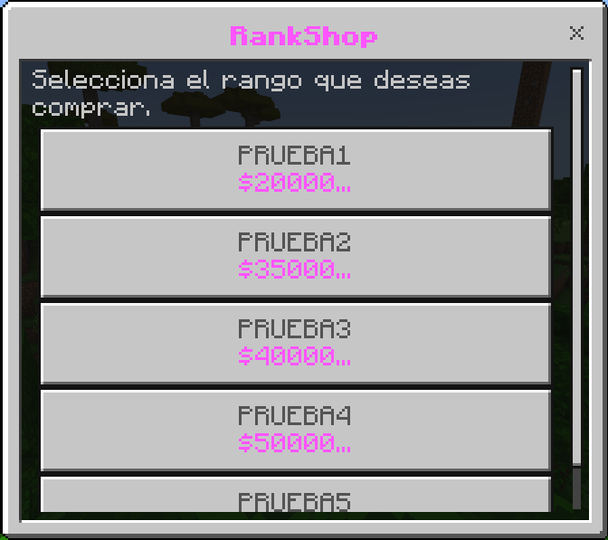
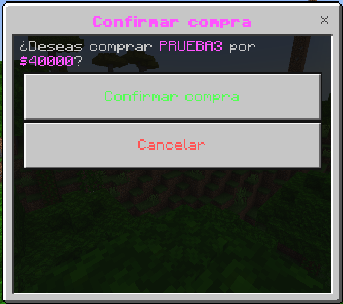
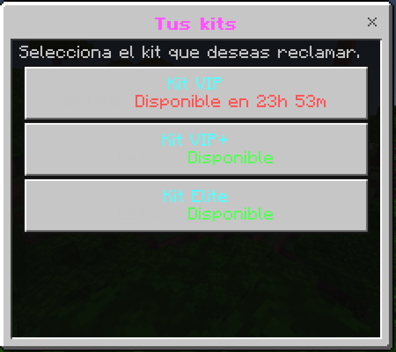
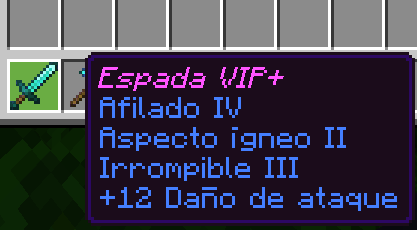
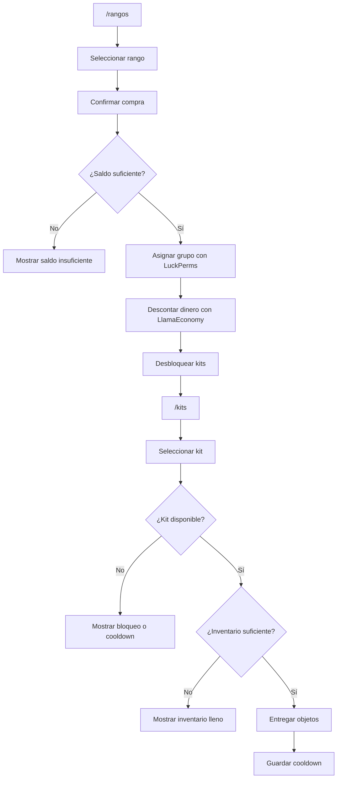

# 💎 RankshopUIV2

<p align="center">
  
  
  
  
  
</p>

<p align="center">
  <b>Una tienda de rangos con interfaz gráfica, economía integrada y kits personalizables para servidores Minecraft Bedrock con Nukkit.</b>
</p>

<p align="center">
  <a href="https://github.com/BrunoJaegerK/RankshopUIV2">Repositorio</a> •
  <a href="https://github.com/BrunoJaegerK/NeoBuyerV2.2">Otro proyecto: NeoBuyerV2.2</a>
</p>

---

## 📑 Índice

- [📋 Descripción](#-descripción)
- [✨ Características](#-características)
- [🖥️ Capturas de pantalla](#️-capturas-de-pantalla)
- [🔄 Funcionamiento](#-funcionamiento)
- [📦 Dependencias](#-dependencias)
- [⚙️ Instalación](#️-instalación)
- [🎮 Comandos](#-comandos)
- [🛒 Configuración de rangos](#-configuración-de-rangos)
- [🎁 Configuración de kits](#-configuración-de-kits)
- [⚔️ Nombres y encantamientos](#️-nombres-y-encantamientos)
- [🌐 Idioma y mensajes](#-idioma-y-mensajes)
- [💾 Datos de jugadores](#-datos-de-jugadores)
- [🧩 Estructura del proyecto](#-estructura-del-proyecto)
- [🔨 Compilar desde el código fuente](#-compilar-desde-el-código-fuente)
- [❓ Solución de problemas](#-solución-de-problemas)
- [👨‍💻 Autor](#-autor)

---

## 📋 Descripción

**RankshopUIV2** es un plugin para servidores de Minecraft Bedrock basados en Nukkit y forks compatibles. Su objetivo es permitir que los jugadores compren rangos con la moneda del servidor y reciban acceso a kits especiales que pueden reclamar desde una interfaz gráfica.

El plugin integra dos sistemas principales:

- **LlamaEconomy:** consulta el saldo del jugador y descuenta el costo de la compra.
- **LuckPerms:** asigna el grupo correspondiente al rango comprado.

Además, incluye un sistema de kits configurables con cooldowns individuales, objetos con nombres personalizados, colores y múltiples encantamientos.

La configuración se administra mediante archivos YAML, por lo que puedes personalizar rangos, precios, kits, mensajes y tiempos de espera sin modificar directamente el código Java.

## ✨ Características

| Función | Descripción |
|---|---|
| 🛒 Tienda de rangos | Muestra los rangos disponibles mediante formularios dentro del juego. |
| ✅ Confirmación de compra | Permite confirmar o cancelar una compra antes de procesarla. |
| 💰 Economía | Comprueba el saldo y descuenta el precio mediante LlamaEconomy. |
| 🛡️ Rangos con LuckPerms | Ejecuta la asignación del grupo configurado en LuckPerms. |
| 🎁 Kits desbloqueables | Cada rango puede desbloquear uno o varios kits. |
| ⏳ Cooldowns individuales | Cada kit tiene su propio tiempo de espera. |
| ⚔️ Objetos personalizados | Admite nombres, colores, cantidades y metadata. |
| ✨ Encantamientos múltiples | Permite configurar varios encantamientos y niveles en un objeto. |
| 💾 Persistencia | Guarda los kits desbloqueados y los cooldowns en el archivo de datos. |
| 🌐 Idioma configurable | Permite editar los mensajes y textos de las interfaces. |
| 📂 Configuración YAML | Separa los rangos, los kits, los mensajes y los datos de jugadores. |
| 🎒 Protección del inventario | Comprueba que haya espacio para los objetos antes de entregarlos. |

## 🖥️ Capturas de pantalla

Las siguientes imágenes están reservadas para capturas reales del plugin en funcionamiento.

### 🛒 Tienda de rangos



*Interfaz con los rangos disponibles y sus precios.*

### ✅ Confirmación de compra



*Formulario para confirmar o cancelar la compra de un rango.*

### 🎁 Menú de kits



*Interfaz que muestra los kits desbloqueados y su disponibilidad.*

### ⚔️ Objetos personalizados



*Ejemplo de objetos con nombres personalizados y encantamientos.*

> **Nota:** sube tus capturas a `docs/images/` con esos nombres para que aparezcan correctamente. Las imágenes anteriores son rutas previstas, no capturas que ya estén incluidas en el repositorio.

## 🔄 Funcionamiento

### 1. Compra de rangos

1. El jugador ejecuta `/rangos`.
2. Se abre la tienda gráfica.
3. El jugador selecciona el rango que desea.
4. El plugin muestra el precio y solicita confirmación.
5. Si confirma, se comprueba su saldo.
6. Se intenta asignar el grupo configurado mediante LuckPerms.
7. Se descuenta el dinero con LlamaEconomy.
8. Se desbloquean los kits vinculados al rango.

### 2. Reclamación de kits

1. El jugador ejecuta `/kits`.
2. El plugin muestra sus kits desbloqueados.
3. Cada kit indica si está disponible o cuánto tiempo falta.
4. Al seleccionar un kit, se comprueba que esté desbloqueado.
5. Se verifica que el cooldown haya terminado.
6. Se valida la configuración de los objetos.
7. Se comprueba que todos los objetos quepan en el inventario.
8. Se entregan los objetos y se guarda el siguiente tiempo de reclamación.

### Diagrama del sistema



> **Importante:** el proceso de compra utiliza una orden de LuckPerms y después descuenta el dinero. No es una transacción atómica: un fallo durante una de esas operaciones podría dejar los resultados parcialmente aplicados. Comprueba la consola si una compra presenta problemas.

## 📦 Dependencias

RankshopUIV2 necesita las siguientes dependencias:

| Dependencia | Función |
|---|---|
| **Nukkit o fork compatible** | Plataforma del servidor donde se ejecuta el plugin. |
| **LlamaEconomy** | Sistema económico utilizado para consultar y descontar dinero. |
| **LuckPerms para Nukkit** | Administración de grupos y permisos de rangos. |

Las versiones de estas dependencias deben ser compatibles con el servidor utilizado.

El plugin comprueba al iniciarse que LlamaEconomy y LuckPerms estén instalados. Si no encuentra alguno de ellos, deshabilita el plugin.

## ⚙️ Instalación

1. Descarga o compila el JAR de Rankshop.
2. Instala LlamaEconomy y LuckPerms en versiones compatibles con tu servidor.
3. Coloca el JAR de Rankshop en la carpeta `plugins/`.
4. Inicia el servidor para que se generen los archivos de configuración.
5. Detén el servidor antes de editar la configuración.
6. Personaliza los archivos dentro de `plugins/Rankshop/`.
7. Inicia de nuevo el servidor.
8. Prueba `/rangos` y `/kits`.

La carpeta de configuración debería contener:

```text
plugins/
└── Rankshop/
    ├── config.yml
    ├── kits.yml
    ├── lang.yml
    └── playerdata.yml
```

`playerdata.yml` se genera para almacenar los datos de los jugadores. No es necesario crearlo manualmente.

> Haz una copia de seguridad de los archivos de configuración y datos antes de actualizar el plugin.

## 🎮 Comandos

| Comando | Alias | Descripción |
|---|---|---|
| `/rangos` | `/ranks`, `/rank` | Abre la tienda de rangos. |
| `/kits` | `/kit` | Abre el menú de kits desbloqueados. |

Estos comandos abren formularios dentro del juego y, por ello, están destinados a jugadores conectados, no a la consola.

## 🛒 Configuración de rangos

El archivo `config.yml` define los rangos, los precios, los grupos de LuckPerms y los kits que desbloquea cada rango.

### Ejemplo de configuración

```yaml
identifiers:
  - "vip"
  - "vipplus"
  - "elite"

"vip":
  name: "VIP"
  lp-user: "vip"
  price: 20000
  kits:
    - "vip"

"vipplus":
  name: "VIP+"
  lp-user: "vipplus"
  price: 35000
  kits:
    - "vipplus"
    - "vip"

"elite":
  name: "Elite"
  lp-user: "elite"
  price: 50000
  kits:
    - "elite"
```

### ¿Qué significa cada opción?

| Opción | Función |
|---|---|
| `identifiers` | Lista de identificadores que aparecen en la tienda. |
| `name` | Nombre que se muestra en el formulario. |
| `lp-user` | Nombre del grupo de LuckPerms que se asigna. |
| `price` | Precio del rango en la moneda de LlamaEconomy. |
| `kits` | Lista de identificadores de kits que se desbloquean. |

### Cómo añadir un rango nuevo

1. Añade su identificador a `identifiers`.
2. Crea una sección con ese mismo identificador.
3. Define `name`, `lp-user` y `price`.
4. Añade los kits que debe desbloquear.
5. Asegúrate de que los grupos de LuckPerms y los kits estén configurados.

**Ejemplo:** para añadir el rango `Legend`, crea el grupo `legend` en LuckPerms, define la sección correspondiente en `config.yml` y asegúrate de que exista el kit `legend` en `kits.yml`.

### ¿Cómo funciona la asignación de rangos?

El código utiliza el comando:

```text
lp user NOMBRE parent add GRUPO
```

Esto **añade el grupo como padre** al usuario; no garantiza que sustituya el rango anterior. Si compras `VIP+` después de tener `VIP`, ambos grupos pueden permanecer asignados.

Para configurar una jerarquía de rangos en la que cada compra sustituya al rango anterior, debes decidir cómo quieres gestionar los grupos y ajustar la lógica de compra o la configuración de LuckPerms. No asumas que el plugin elimina automáticamente los rangos anteriores.

También es recomendable probar las compras con precios de prueba y revisar los permisos antes de utilizarlo en un servidor público.

## 🎁 Configuración de kits

El archivo `kits.yml` define los objetos y las condiciones de reclamación de cada kit.

### Ejemplo

```yaml
vip:
  name: "Kit VIP"
  cooldown-seconds: 86400
  items:
    - "276:0:1:&dEspada VIP:9:3:13:2"
    - "278:0:1:&bPico VIP:15:3:17:2"
    - "322:0:8:&6Manzana dorada"

vipplus:
  name: "Kit VIP+"
  cooldown-seconds: 172800
  items:
    - "276:0:1:&dEspada VIP+:9:4:13:2"
    - "322:0:12:&6Manzana dorada"
```

### Opciones de un kit

| Opción | Descripción |
|---|---|
| `vip` | Identificador interno del kit. |
| `name` | Nombre visible del kit. |
| `cooldown-seconds` | Tiempo de espera expresado en segundos. |
| `items` | Lista de objetos que se entregan al reclamar el kit. |

### Ejemplos de cooldowns

| Valor | Tiempo de espera |
|---:|---|
| `0` | Sin espera entre reclamaciones. |
| `3600` | 1 hora. |
| `86400` | 24 horas. |
| `172800` | 48 horas. |
| `259200` | 72 horas. |

El cooldown empieza cuando el jugador reclama el kit. El tiempo se guarda en `playerdata.yml`, por lo que continúa contando aunque el servidor se reinicie.

### Asociar kits a rangos

Los kits se vinculan desde `config.yml`:

```yaml
"vip":
  name: "VIP"
  lp-user: "vip"
  price: 20000
  kits:
    - "vip"
    - "vipplus"
```

En este ejemplo, la compra del rango desbloquea los dos kits indicados. El nombre del kit debe coincidir con su identificador en `kits.yml`.

Los kits se desbloquean al comprar el rango; el plugin no comprueba automáticamente si el jugador ya tenía ese grupo antes de la compra.

## ⚔️ Nombres y encantamientos

RankshopUIV2 permite configurar nombres personalizados y varios encantamientos para un mismo objeto desde `kits.yml`.

### Formatos admitidos

| Formato | Resultado |
|---|---|
| `ID:META:CANTIDAD` | Objeto básico. |
| `ID:META:CANTIDAD:NOMBRE` | Objeto con nombre personalizado. |
| `ID:META:CANTIDAD:NOMBRE:ENCANTAMIENTO:NIVEL` | Objeto con un encantamiento. |
| `ID:META:CANTIDAD:NOMBRE:ENCANTAMIENTO:NIVEL:ENCANTAMIENTO:NIVEL` | Objeto con varios encantamientos. |

### Ejemplo con varios encantamientos

```yaml
items:
  - "276:0:1:&dEspada VIP:9:3:13:2"
```

El formato se interpreta de la siguiente manera:

| Valor | Significado |
|---|---|
| `276` | ID del objeto. |
| `0` | Metadata del objeto. |
| `1` | Cantidad. |
| `&dEspada VIP` | Nombre personalizado en color morado claro. |
| `9:3` | Encantamiento con ID `9`, nivel `3`. |
| `13:2` | Segundo encantamiento con ID `13`, nivel `2`. |

Los identificadores de objetos y encantamientos deben corresponder a los disponibles en la versión de Nukkit utilizada. Los ID del ejemplo no deben considerarse universales para todas las versiones.

### Colores del nombre

Puedes usar códigos de color con `&` en el nombre personalizado:

```yaml
items:
  - "276:0:1:&dEspada VIP"
  - "276:0:1:&6Espada Legend"
  - "276:0:1:&cEspada Hero"
```

El plugin convierte `&` al símbolo de formato `§`.

### Mantener el nombre original

Puedes utilizar `default` para no asignar un nombre personalizado:

```yaml
items:
  - "276:0:1:default:9:3"
```

Si añades encantamientos, cada uno necesita dos valores: el ID del encantamiento y su nivel. Los niveles deben ser positivos.

> **Consejo:** si un objeto no aparece correctamente, revisa el formato, la cantidad, el ID del objeto y los ID de los encantamientos. Una configuración inválida puede impedir que se reclame el kit.

## 🌐 Idioma y mensajes

El archivo `lang.yml` permite personalizar los textos que se muestran a los jugadores.

### Secciones principales

| Sección | Contenido |
|---|---|
| `forms.shop` | Título, descripción y botones de la tienda. |
| `forms.confirmation` | Confirmación y cancelación de compra. |
| `forms.kits` | Título, descripción y estado de los kits. |
| `messages` | Mensajes de errores, compras, cooldowns y reclamaciones. |

### Marcadores dinámicos

Algunos textos utilizan marcadores que el plugin sustituye automáticamente:

| Marcador | Contenido |
|---|---|
| `{rank}` | Nombre del rango. |
| `{price}` | Precio del rango. |
| `{kit}` | Nombre del kit. |
| `{time}` | Tiempo restante del cooldown. |
| `{status}` | Estado del kit en el formulario. |

Ejemplo:

```yaml
messages:
  purchase-success: "§aHas comprado el rango §d{rank}§a correctamente."
  kit-cooldown: "§cPodrás reclamar este kit en §e{time}§c."
  kit-claimed: "§aHas reclamado el kit §b{kit}§a."
```

Conserva los marcadores al traducir o personalizar los textos para que el plugin pueda reemplazarlos correctamente.

## 💾 Datos de jugadores

El archivo `playerdata.yml` almacena información persistente de cada jugador.

Incluye principalmente:

- **Kits desbloqueados:** los kits que el jugador ha obtenido mediante la compra de rangos.
- **Cooldowns:** el momento a partir del cual puede volver a reclamar cada kit.

Ejemplo ilustrativo de la estructura de datos:

```yaml
players:
  nombrejugador:
    unlocked-kits:
      - "vip"
    cooldowns:
      vip: 1790000000
```

El valor del cooldown es una marca de tiempo Unix expresada en segundos. El ejemplo es únicamente ilustrativo; el plugin genera y administra los datos reales.

No edites ni elimines este archivo mientras el servidor está en funcionamiento. Haz una copia de seguridad antes de realizar cambios manuales.

## ❓ Solución de problemas

<details>
<summary><b>El plugin no se habilita al iniciar</b></summary>

Comprueba que LlamaEconomy y LuckPerms estén instalados y que sean compatibles con tu servidor. Revisa la consola para encontrar el mensaje de error y confirma que el archivo JAR de Rankshop esté en la carpeta `plugins/`.
</details>

<details>
<summary><b>No aparece un rango en la tienda</b></summary>

Verifica que su identificador esté incluido en `identifiers` en `config.yml` y que tenga una sección con su nombre, grupo y precio.
</details>

<details>
<summary><b>El jugador no tiene suficiente dinero</b></summary>

Comprueba su saldo en LlamaEconomy y verifica que el precio configurado sea correcto.
</details>

<details>
<summary><b>El jugador compra un rango, pero no obtiene el grupo esperado</b></summary>

Comprueba que `lp-user` coincida con el nombre del grupo en LuckPerms. Revisa también los permisos para ejecutar comandos de LuckPerms desde la consola del servidor.
</details>

<details>
<summary><b>El jugador compra un rango, pero no ve su kit</b></summary>

Revisa que el kit esté incluido en la lista `kits` del rango y que su identificador exista en `kits.yml`. Recuerda que el plugin desbloquea los kits cuando se realiza una compra; no sincroniza automáticamente los kits con los grupos que el jugador ya tenía.
</details>

<details>
<summary><b>El jugador no puede reclamar un kit</b></summary>

Comprueba que el kit esté desbloqueado, que el cooldown haya terminado, que el kit contenga objetos válidos y que haya espacio suficiente en el inventario.
</details>

<details>
<summary><b>Los objetos personalizados no funcionan</b></summary>

Revisa el orden de los valores, la cantidad, la metadata, los códigos de color y los pares de ID y nivel de los encantamientos. Los ID deben ser compatibles con tu versión de Nukkit.
</details>

<details>
<summary><b>Los kits o cooldowns parecen haberse reiniciado</b></summary>

Comprueba que `playerdata.yml` exista y que el servidor tenga permisos de escritura en la carpeta del plugin. Evita borrar el archivo al actualizarlo y conserva copias de seguridad.
</details>

<details>
<summary><b>La compilación falla en IntelliJ</b></summary>

Ejecuta `.\gradlew.bat clean build` desde la raíz del proyecto y revisa el primer error de Gradle. Comprueba que los JAR de `libs/` existan y que el JDK seleccionado sea compatible.
</details>

## 🔐 Recomendaciones para administradores

- Crea y prueba los grupos de LuckPerms antes de publicar los rangos.
- Prueba las compras con precios bajos en un servidor de desarrollo.
- Haz copias de seguridad de `config.yml`, `kits.yml` y `playerdata.yml`.
- Comprueba que los objetos y encantamientos funcionen en la versión exacta del servidor.
- No compartas datos privados ni credenciales en los archivos del repositorio.
- Verifica que la lógica de rangos coincida con la jerarquía de permisos que deseas utilizar.

## 👨‍💻 Autor

**Desarrollado por BrunoJaegerK**

- GitHub: [@BrunoJaegerK](https://github.com/BrunoJaegerK)
- Repositorio: [RankshopUIV2](https://github.com/BrunoJaegerK/RankshopUIV2)
- Otro proyecto: [NeoBuyerV2.2](https://github.com/BrunoJaegerK/NeoBuyerV2.2)

---

<p align="center">
</p>
